# WordPress on GCP — Infrastructure as Code


> **Refactor complete in the code; the verification deploy is pending.** The project was refactored towards a production-ready setup: a naming convention for every resource, the management VPC removed, a dedicated subnet for the image build, one service account per pipeline job, an edge layer with Cloud Armor, Cloud CDN and a backend bucket for uploads, and the admin area behind Identity-Aware Proxy, added after a bot took over the installer of the first verification deploy. A deploy from scratch confirms it (task R22 in [docs/to-do.md](docs/to-do.md)). The screenshots are from the deploy before the refactor and still show the old resource names.

**Terraform, Packer and Cloud Build code that deploys WordPress into a Google Cloud project of your own: an auto-healing managed instance group behind a global HTTPS load balancer with Cloud Armor and Cloud CDN, the admin area behind Identity-Aware Proxy, Cloud SQL on a private IP, scheduled backups and credentials in Secret Manager.** Infrastructure changes go through pull requests: plan on every PR, apply of the plan generated on `main` by a manual, approved trigger.

> **Note:** This is a portfolio project, not a production deployment. Some cost-optimized values (instance tier, disk size) differ from production recommendations documented in the code. Known gaps are listed in [Known Limitations](#known-limitations).

---

## Quickstart

The minimum sequence for a first deploy, from [Cloud Shell](https://shell.cloud.google.com). Each step is explained in [Deployment](#deployment).

```bash
# 1. Project with billing (Step 1)
export PROJECT_ID="your-gcp-project-id"
gcloud projects create $PROJECT_ID --name="WordPress on GCP"
gcloud config set project $PROJECT_ID
gcloud billing projects link $PROJECT_ID --billing-account=BILLING_ACCOUNT_ID

# 2. Repository and variables (Steps 2 and 3)
gh repo clone YOUR_GITHUB_USERNAME/gcp-wordpress-blueprint
cd gcp-wordpress-blueprint
export REPO_NAME="gcp-wordpress-blueprint"
export REPO_OWNER="your-github-username-or-org"
export IAP_USER_EMAIL="you@example.com"
export DOMAIN_NAMES="wordpress.example.com"
export RESERVE_LB_IP="true"

# 3. Connect the repository in the console (Step 4):
#    Cloud Build → Triggers → Connect Repository → GitHub

# 4. Bootstrap (Step 5); then point your domain's DNS A record to the IP it prints
bash configs/setup.sh
#    Only if the project is in an organization (Step 5b)
bash configs/org-policy-exception.sh

# 5. First image, plan and apply (Steps 6 to 8)
SA_PREFIX="projects/${PROJECT_ID}/serviceAccounts"
SA_SUFFIX="@${PROJECT_ID}.iam.gserviceaccount.com"
gcloud builds submit --project=$PROJECT_ID --config=cloudbuild/packer.yaml \
  --substitutions="_PROJECT_ID=$PROJECT_ID,_ZONE=europe-west1-b,_ENVIRONMENT=prod,_USE_IAP=false" \
  --service-account="${SA_PREFIX}/packer-build-sa${SA_SUFFIX}"
gcloud builds submit --project=$PROJECT_ID --config=cloudbuild/terraform-plan.yaml \
  --substitutions="^;^_PROJECT_ID=$PROJECT_ID;_STATE_BUCKET=${PROJECT_ID}-tfstate;_IAP_USER_EMAIL=$IAP_USER_EMAIL;_DOMAIN_NAMES=$DOMAIN_NAMES;_SAVE_PLAN=true" \
  --service-account="${SA_PREFIX}/terraform-plan-sa${SA_SUFFIX}"
gcloud builds submit --project=$PROJECT_ID --config=cloudbuild/terraform-apply.yaml \
  --substitutions="_PROJECT_ID=$PROJECT_ID,_STATE_BUCKET=${PROJECT_ID}-tfstate,_PLAN_BUILD_ID=PLAN_BUILD_ID" \
  --service-account="${SA_PREFIX}/terraform-apply-sa${SA_SUFFIX}"

# 6. Install WordPress at https://your-domain/ signed in as IAP_USER_EMAIL, then run the
#    smoke tests with the load_balancer_ip output of the apply (Step 8)
bash tests/smoke/edge-security.sh your-domain LOAD_BALANCER_IP

# 7. Optional: remove the default network, used only by the first image build (Step 9)
bash configs/delete-default-network.sh
```

`PLAN_BUILD_ID` is the `BUILD_ID` printed by the plan build. Tear everything down with [Destroy](#destroy) when you are done: the regional Cloud SQL instance is billed while it is up.

---

## Architecture

<a href="docs/architecture-v2.png">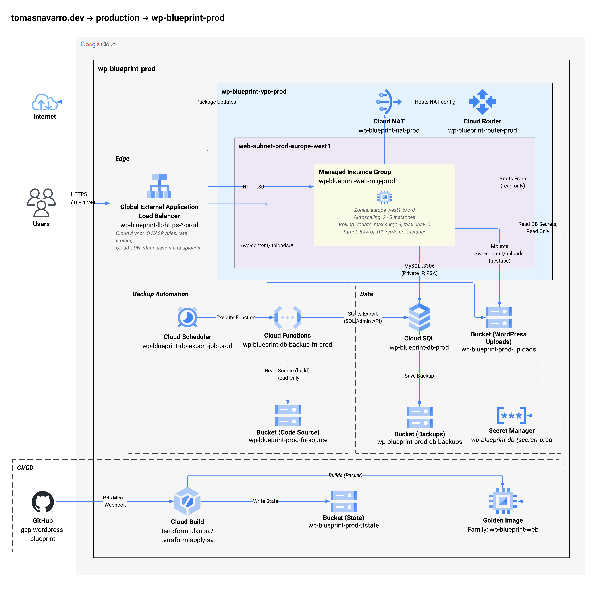</a>

*Click the diagram to open it at full size.*

*Not shown: `build-subnet-prod-europe-west1`, a subnet of the same VPC that only hosts the ephemeral Packer VM during an image build (see [Immutable Infrastructure with Packer](#immutable-infrastructure-with-packer)).*

The diagram follows the [GCP diagram style guide and naming conventions](https://tomasnavarro.hashnode.dev/gcp-diagram-style-guide-and-naming-conventions-by-tomas-navarro).

### Overview

Traffic enters through a **Global External Application Load Balancer**, which terminates HTTPS with a Google-managed certificate and redirects HTTP to HTTPS. **Cloud Armor** filters the requests that reach the instances, and **Cloud CDN** caches static content. Only the site's own domains are served: any other `Host` header gets a 403. WordPress uploads (`/wp-content/uploads/*`) are served from a private **Cloud Storage** bucket through a backend bucket; every other request goes to a **Regional Managed Instance Group** (MIG) of WordPress instances in the production VPC. The admin area and the login reach the same instances through a second backend service behind **Identity-Aware Proxy (IAP)**, so only the operator's Google account gets to them.

The instances connect to **Cloud SQL (MySQL 8.4)** exclusively via private IP — no public database endpoint exists — and mount the uploads bucket, so they keep no state. They have no external IP: outbound traffic goes through **Cloud NAT**, and traffic to Google APIs through Private Google Access. SSH is exclusively through **Identity-Aware Proxy (IAP)**.

A **Cloud Function (v2)** triggered by **Cloud Scheduler** exports the database to Cloud Storage every day, and Cloud SQL keeps automated backups with point-in-time recovery. Database credentials are stored in **Secret Manager** and read by the instances at startup.

---

## Key Design Decisions

### Naming Convention
Every resource name follows `[project]-[component]-[environment]`, lowercase, hyphens only, with the short project name `wp-blueprint`: `wp-blueprint-vpc-prod`, `wp-blueprint-web-mig-prod`, `wp-blueprint-db-prod`. Subnets carry the region at the end (`web-subnet-prod-europe-west1`), buckets start with the project ID because their names are unique across all of GCP (`<project_id>-uploads`), and service accounts carry no environment, since each project has its own copy (`web-vm-sa`). The convention is described in the [GCP diagram style guide and naming conventions](https://tomasnavarro.hashnode.dev/gcp-diagram-style-guide-and-naming-conventions-by-tomas-navarro).

Names are built in `terraform/locals.tf` from `name_prefix` and the `environment` variable, not set one by one in variables: each has one job, and some are rebuilt by scripts outside Terraform (`configs/setup.sh`, `configs/destroy.sh`, the Packer template), which say so next to them.

### Regional MIG over Unmanaged Instance Group
The production workload uses a Regional Managed Instance Group with auto-healing, a named HTTP port for load balancer integration, and distribution across three zones (`europe-west1-b/c/d`). An instance that fails its health check is replaced automatically, and the autoscaler adds instances under load (2 to 3) — not achievable with a UMIG.

`min_replicas = 2`: two instances run at all times, in different zones, so one can be replaced (a rolling update, auto-healing, a zone outage) while the other serves. With a single instance, every replacement is downtime.

### One VPC, Two Subnets
The production VPC (`wp-blueprint-vpc-prod`) has two subnets in `europe-west1`:

- **Web** (`web-subnet-prod-europe-west1`, `10.0.0.0/24`): the WordPress instances.
- **Build** (`build-subnet-prod-europe-west1`, `10.0.1.0/28`): only the ephemeral VM Packer creates during an image build. Its own subnet and network tag (`packer-build`) keep its firewall rules apart from the web ones: SSH through IAP is allowed, and egress to the Private Service Access range, where Cloud SQL has its private IP, is denied. The build VM has no reason to reach the database.

An earlier version had a second, management VPC peered with this one. It was removed: VPC peering is not transitive, so the management VM could not reach Cloud SQL's private IP anyway, and the peering opened routes between both networks without isolating anything. The security boundary is IAM, firewall rules and IAP; separation between environments is done with one project per environment.

The network is built with Google's official modules (`terraform-google-modules/network` and `cloud-router`), pinned to exact versions. Both subnets have **Private Google Access**, so traffic to Google APIs (Secret Manager, Cloud Storage, Logging) goes straight to Google instead of through Cloud NAT, which is left for the internet.

### Private IP for Cloud SQL
`ipv4_enabled = false` — the database has no public endpoint. The instances connect via private IP within the VPC, through a Private Service Access connection (`private_service_access.tf`). There is no administrative access path to the database yet (see [Known Limitations](#known-limitations)).

### IAP for SSH — No Public IPs, No Bastion
SSH access is granted through IAP tunnel access (`roles/iap.tunnelResourceAccessor`) to a specific operator email. No instance has an external IP address, and no bastion host is required.

The operator email is not committed: it is passed to the pipeline as the `_IAP_USER_EMAIL` substitution and validated at plan time. In a production environment the binding would go to a Google group (`group:infra-admins@example.com`) instead of a user, so that team changes do not require a Terraform change. The same account reaches the admin area through IAP (next section); moving both accesses to a group is task T46 in [docs/to-do.md](docs/to-do.md).

### Admin Area behind IAP
A fresh WordPress is installed by whoever completes `/wp-admin/install.php` first, and the installer asks for no credentials. In the first verification deploy a bot did exactly that within hours of the deploy, on the site's own domain, most likely found in Certificate Transparency logs, and then tried to edit a theme file to run PHP (`DISALLOW_FILE_MODS` stopped it). The timeline and the evidence are in [devlog-2026-10-26-verification.md](docs/devlogs/devlog-2026-10-26-verification.md) (E4); the decisions that followed, the options considered and the sources, in [devlog-2026-10-30.md](docs/devlogs/devlog-2026-10-30.md).

So the admin area and the login are only reachable through IAP, from the first apply:

- **Routing.** `/wp-admin`, `/wp-admin/*` and `/wp-login.php` go to a second backend service on the same MIG, with IAP enabled. Only principals with `roles/iap.httpsResourceAccessor` on it get through, after signing in with Google: today the operator account (`IAP_USER_EMAIL`). `/wp-admin/admin-ajax.php` stays on the public backend, because themes and plugins call it from the public site.
- **Installation.** The installer is under `/wp-admin`, so it is behind IAP too. The operator completes it once from the browser (see [Step 8](#step-8-apply-the-plan)).
- **Two Cloud Armor policies.** On a global external Application Load Balancer, Cloud Armor is evaluated before IAP, and a rule cannot tell which backend a request goes to. The public backend therefore has its own policy, which blocks any path that contains a protected one, after decoding and lowercasing it: Apache and PHP serve variants such as `/wp-login.php/x` or `//wp-admin/` that the path rules of the URL map do not match, and those would otherwise skip IAP. The backend behind IAP has a policy without that rule (see [Edge](#edge-cloud-armor-and-cloud-cdn)).
- **Application passwords disabled.** They authenticate the REST API, which is served by the public backend, so one of them would reach WordPress as a logged-in user without going through IAP. A must-use plugin in the image turns them off.
- **The paths are a local, not a variable** (`terraform/locals.tf`), so configuration cannot turn the protection off. In the load balancer module IAP is optional, so the module can be reused without it.

Alternatives considered: installing WordPress from the startup script with WP-CLI, which with two instances needs a lock so that only one installs, and passes the admin credentials through Secret Manager and the boot logs; and an IP allowlist, which still leaves the installation as a manual step, breaks when the operator's IP changes, and trusts an IP rather than an identity.

IAP uses the Google-managed OAuth client, which only admits users of the project's organization: the project must be in an organization, and `IAP_USER_EMAIL` must be an account of it (see [Prerequisites](#prerequisites)).

How all of this is tested, with a smoke test script and manual checks, is in [docs/test-procedure.md](docs/test-procedure.md).

### Global HTTPS Load Balancer with a Managed Certificate
The load balancer is global rather than regional because Google-managed SSL certificates, which Google issues and renews on its own, attach to the global external Application Load Balancer. The certificate is only issued once the DNS A record of the domain points to the load balancer IP, and that can take from 15 minutes to over an hour after the first deploy.

- **TLS ends at the load balancer.** Backends receive plain HTTP on port 80 inside the VPC. WordPress reads the `X-Forwarded-Proto` header the load balancer sets, so it knows the visitor is on HTTPS; without that it produces blocked `http://` assets and a redirect loop in the admin area. The block is baked into the image by `packer/scripts/install.sh`.
- **HTTP redirects to HTTPS.** A second forwarding rule on port 80, on the same IP, answers every request with a 301 to HTTPS.
- **Minimum TLS 1.2.** An SSL policy (`MODERN` profile) replaces the default one, which still accepts TLS 1.0.
- **One firewall rule for the Google front ends.** With a global load balancer, health check probes and proxied client traffic reach the backends from the same Google ranges (`35.191.0.0/16`, `130.211.0.0/22`). The rule lives in the load balancer module and targets only instances tagged `backend-service`.

### Edge: Cloud Armor and Cloud CDN
Everything at the edge lives in `terraform/modules/global_external_lb`. The decisions, the options considered and the sources are in [docs/devlogs/devlog-2026-10-25.md](docs/devlogs/devlog-2026-10-25.md).

**Only the site's domains.** The client writes the `Host` header, so it can be anything: the load balancer IP, Google's reverse DNS name for it, or someone else's domain. Bots that sweep cloud IP ranges send those, and in the first verification deploy they reached the WordPress installer that way. The host rule of the URL map only takes `domain_names`; any other host goes to the URL map default. The URL map has no "deny" action, and its default can only be a backend service, a backend bucket or a redirect: a redirect would hand the site's domain to whoever asked, and a bucket would be one more thing reachable from anywhere. So the default is the public backend service, where the first Cloud Armor rule answers 403 to any host that is not one of `domain_names`. WordPress also takes its own address from configuration (`WP_HOME` and `WP_SITEURL`, set at boot from the first domain), never from the request, so links and the password reset email always point to the site's domain.

**Uploads from a private bucket.** The URL map sends `/wp-content/uploads/*` to a backend bucket on the uploads bucket, and everything else to the instances. The objects are stored under the same path WordPress serves them from, so no URL rewrite is needed. The bucket stays private: the load balancer reads it with a Google-managed service account (Private Bucket Access), so public access prevention stays enforced like on every other bucket. Objects can only be read through the load balancer, not straight from Cloud Storage.

**Uploads are public by design.** WordPress serves its uploads as static files without checking who asks: an image in a private post is still readable by URL. The bucket being private does not change that; it only leaves the load balancer as the single way in. Per-user private files would need application-level access control, such as signed URLs, and a separate bucket. A plugin that protects files inside `uploads` with `.htaccess` is not compatible with this setup, because those requests never reach Apache.

**Cloud CDN** on both backends, with a different cache mode on each:

| Backend | Cache mode | TTL | Why |
|---|---|---|---|
| Uploads bucket | `FORCE_CACHE_ALL` | 1 hour, also for browsers | Required to cache a private bucket. Safe: a bucket returns the same object to everyone for a URL |
| Instances | `CACHE_ALL_STATIC` | 1 hour by default, 1 day at most | Caches static assets but never responses with `Set-Cookie`, `Cache-Control: private` or HTML, so pages of logged-in users are never cached |

A new upload gets a new file name and is never served stale. The TTL bounds how long a deleted file keeps being served; an urgent removal is invalidated by hand (see [Remove an upload from the cache](#remove-an-upload-from-the-cache)).

**Cloud Armor**, with one policy per backend service (see [Admin Area behind IAP](#admin-area-behind-iap)), evaluated on every request that reaches the instances. Each rule is defined once in the module and each policy takes the ones it needs:

| Priority | Rule | Public backend | Backend behind IAP |
|---|---|---|---|
| 50 | `Host` that is not one of `domain_names`, or no `Host` | `403` | `403` |
| 100 | `xmlrpc.php`. Not used by this site, and `system.multicall` tries hundreds of passwords in one request | `403` | — (never routed there) |
| 150 | A path that contains `/wp-admin` or `/wp-login.php`, after decoding and lowercasing it, except `/wp-admin/admin-ajax.php` | `403` | — |
| 200 | `POST` to `wp-login.php`, per IP | — (the login is behind IAP) | 5 attempts per minute, `429` over that; over 50 in 10 minutes, the IP is banned for 30 minutes |
| 1000–1010 | Preconfigured WAF rules, OWASP Core Rule Set 4.22, sensitivity 1 | `403`, in **preview** (`waf_preview = true`): they only log what they would block | Same |
| default | Everything else | Allowed | Allowed |

The login rate limit still matters behind IAP: a Google account with access, if compromised, could try WordPress passwords. The policy of the backend behind IAP also sees the requests IAP is about to reject, since it runs first.

The WAF rules start in preview because the WordPress admin area sends HTML and scripts that can look like attacks. Their matches are reviewed in the load balancer logs, which record every request and Cloud Armor's decision on it, before they are enforced (see [Review and enforce the WAF rules](#review-and-enforce-the-waf-rules)).

### Reserved IP for the Load Balancer
A deploy that creates its own IP gets a different address every time, so the DNS record has to be updated and the certificate waits for DNS again. With `lb_use_reserved_ip = true` the load balancer uses a global IP reserved once by `configs/setup.sh` (`wp-blueprint-lb-ip-prod`), outside Terraform. It survives `terraform destroy`, so the DNS record is set once.

A reserved IP is billed while no load balancer is using it. For a portfolio project that is torn down between tests, release it when a test session ends (see [Destroy](#destroy)), or set both `RESERVE_LB_IP` and `lb_use_reserved_ip` to `false` to let Terraform create and destroy the IP with the load balancer.

### Stateless WordPress Instances
Instances in a MIG are replaced at any time: auto-healing, a new image, scaling in. Anything written to their disks is lost, and a file written by one instance does not exist on the others. WordPress keeps writing two kinds of content at runtime, and each is handled differently:

- **Uploads (media).** Stored in the uploads bucket (`<project_id>-uploads`), in the folder `wp-content/uploads/`, which every instance mounts at `wp-content/uploads` with [Cloud Storage FUSE](https://docs.cloud.google.com/storage/docs/cloud-storage-fuse/overview). An image uploaded through one instance is visible from all of them and survives their replacement. WordPress needs no plugin and no change: it writes to what looks like a local folder. Visitors get the files from the load balancer and Cloud CDN, not from the instances.
- **Plugins, themes and languages.** Part of the image. `DISALLOW_FILE_MODS` stops the admin panel from installing, updating or editing them, since a change made there would exist on one instance only. A new plugin, an update or a new language is a new image and a rolling update.

How the mount is wired:

- The image only installs `gcsfuse` (pinned version, from Google's signed apt repository) and creates the mount point. It is the same image for any project.
- Every name the startup script needs reaches the instances as instance metadata, set by Terraform from the same values it uses to create those resources: the bucket and the folder to mount (`uploads-bucket`, `uploads-folder`) and the names of the database secrets (`secret-db-*`). Nothing is hardcoded in the script, and what is created and what is used cannot differ. The script stops if a key is missing.
- `gcsfuse` authenticates as the instance service account (`web-vm-sa`), which has `roles/storage.objectUser` on that bucket only. No service account keys.
- The mount happens before the readiness marker, so an instance that fails to mount is reported unhealthy and replaced.
- The bucket holds data: `force_destroy = false`, protected in the destructive change check, versioned (overwritten or deleted files kept for 30 days), and without a retention policy, which Cloud Storage FUSE cannot write to.

Cloud Storage FUSE is not a POSIX file system: it has higher latency than a local disk and no file locking. That suits uploads, which are written once and read many times.

### Immutable Infrastructure with Packer
WordPress instances are deployed from a golden image built with Packer (`packer/wordpress.pkr.hcl`). The image includes WordPress, PHP, and all dependencies pre-installed. Terraform resolves the `wp-blueprint-web` image family to the concrete latest image on every plan, so a new build shows up as an instance template replacement and the MIG rolls it out.

- **Pinned and verified downloads.** WordPress (7.1.3), its core language packs for ten locales (`de_DE`, `es_AR`, `es_ES`, `fr_FR`, `it_IT`, `ja`, `nl_NL`, `pl_PL`, `pt_BR`, `ru_RU`) and those of the default theme are downloaded at exact versions, and nothing is extracted until every file matches the SHA256 committed in `packer/scripts/checksums.sha256`. WordPress publishes only SHA1, so the SHA256 is computed once, after checking the archive against the official SHA1, by `packer/scripts/update-checksums.sh` (see [Update the WordPress image](#update-the-wordpress-image)); the build never fetches a checksum from the same server as the file. The Packer plugin is pinned too: Packer has no lock file. The languages are in the image because `DISALLOW_FILE_MODS` turns off their installation from the admin panel; the site language is chosen in *Settings → General*.
- **Build VM in the build subnet, through IAP.** Packer creates the temporary VM in the build subnet, with no external IP, and reaches it through an IAP tunnel. The network names are built in the Packer template from the environment, with the same convention as Terraform.
- **No service account on the build VM.** It only installs packages from the internet and needs no Google credentials. Without this it would run as the Compute Engine default service account, whose permissions anything running in the VM could use. Packer creates the image from outside, with its own pipeline service account.
- **First build, the one exception.** The production VPC is created by Terraform, and Terraform needs an image to exist first. So the very first build runs in the `default` network with `_USE_IAP=false`: the build VM gets an external IP for a few minutes. After the first apply, `configs/delete-default-network.sh` removes the `default` network and its open firewall rules. A separate network root with its own state would remove this exception, and is left for when a second environment is added.

### Backups: Daily Export and Point-in-Time Recovery
- **Daily export** (Cloud SQL export to a SQL file in Cloud Storage) — at midnight (`Europe/Paris`), deleted after 90 days by a lifecycle rule on the backup bucket. Full data portability, and independent of the instance: it survives if the instance is deleted.
- **Point-in-time recovery** — the Cloud SQL instance has automated daily backups and binary logging enabled: 7 days of transaction logs, the maximum for MySQL on Enterprise edition, and 8 retained backups, one more than the days of logs as Google recommends. A restore can go to any moment of the last 7 days, and always creates a new instance. The backup window starts at 02:00 UTC, a few hours after the daily export.

The export is triggered by a Cloud Scheduler job invoking a Cloud Function v2. An earlier version also took an on-demand snapshot every 4 hours; it was removed, because point-in-time recovery already covers that with finer granularity, and on-demand backups were never deleted.

### One Service Account per Pipeline Job
The pipeline runs each job with its own service account, created by `configs/setup.sh`:

| Service account | Triggers | Can do |
|---|---|---|
| `terraform-plan-sa` | Plan on pull requests, plan on `main` | Read only: `roles/viewer`, `roles/iam.securityReviewer`, plus what the plan reads beyond that, each scoped to one resource (the state bucket, the database password secret, the objects Terraform manages) |
| `terraform-apply-sa` | Apply, manual and approved | The write roles that create and change the project |
| `packer-build-sa` | Image build | Create the build VM and the image, and open the IAP tunnel |

A `terraform plan` runs code from the pull request: providers, data sources, even an `external` data source that runs any command. With a single account holding write roles, a malicious pull request could use those permissions during its plan, before anyone approved anything. With a read-only plan account, the most a pull request can do is read; writing is reserved for the approved apply.

### Dedicated Build Identity for the Backup Function
A Cloud Function v2 involves three identities, and they are easy to confuse:

| Identity | What it does | In this project |
|---|---|---|
| Deployer | Creates the function | `terraform-apply-sa`, the apply pipeline service account |
| Build | Runs the Cloud Build that turns the source into a container image | `db-backup-build-sa` |
| Runtime | Runs the function code | `db-backup-fn-sa` |

Left unset, the build identity is the Compute Engine default service account, which then needs broad roles added by hand. This project gives the build its own service account with three roles:

- `roles/logging.logWriter`, to write the build logs.
- `roles/artifactregistry.writer`, to push the image to the `gcf-artifacts` repository.
- `roles/storage.objectViewer`, to read the source.

Two details shaped how those roles are granted:

- **The build does not read the source from the bucket you upload it to.** Cloud Functions first copies the zip to a bucket it creates itself, `gcf-v2-sources-<project number>-<region>`, and builds from there. That bucket and the `gcf-artifacts` repository do not exist before the first deploy, so the roles cannot be bound on them beforehand and are granted at project level. An IAM condition limits the storage role to buckets named `gcf-v2-sources-*`; without it the build identity could read every bucket in the project, including the database exports.
- **IAM bindings take time to propagate.** Created in the same apply as the function, they are not effective yet when the build starts a few seconds later, and the build fails for lack of a permission that is already granted. A 120-second wait (`time_sleep`) sits between the bindings and the function.

### Secret Manager for Credentials
WordPress database credentials (`wp-blueprint-db-name-prod`, `wp-blueprint-db-user-prod`, `wp-blueprint-db-password-prod`, `wp-blueprint-db-host-prod`) are stored as secrets and read by the instances at startup via the startup script, which writes them into `wp-config.php` on the instance. The instance service account has `roles/secretmanager.secretAccessor` on each secret individually (least privilege).

**The database password never reaches the Terraform state or a saved plan.** Both are files in a bucket, and a secret stored in them is a secret stored outside Secret Manager. Terraform generates and delivers the password with ephemeral resources and write-only arguments:

```text
ephemeral random_password ──► Secret Manager ──(ephemeral read)──► Cloud SQL user
     generated per run        secret_data_wo                        password_wo
```

- An **ephemeral resource** exists only while Terraform runs: its value is used and discarded.
- A **write-only argument** is sent to the API and not stored. Terraform cannot tell whether it changed, so each one comes with a version number, and the value is sent again only when that number changes.
- **Secret Manager is the source of truth.** The Cloud SQL user takes the password from the secret, not from the generator, so the two always hold the same value, even if an apply fails halfway. It is read with an `ephemeral` block and not a `data` source, which would store it in the state.

The other three values (database name, user and host) are not sensitive and are stored as regular secret versions. See [Rotate the database password](#rotate-the-database-password) for how the version number is used.

---

## GCP Services

| Service | Purpose |
|---|---|
| Compute Engine (Regional MIG) | Auto-healing WordPress instances across 3 zones |
| Cloud SQL (MySQL 8.4) | Managed relational database, regional (high availability), private IP only, point-in-time recovery |
| Cloud Load Balancing | Global External Application LB: HTTPS with a Google-managed certificate, HTTP to HTTPS redirect, TLS 1.2 minimum, uploads routed to a backend bucket |
| Cloud Armor | Security policy on the backend service: `xmlrpc.php` blocked, login rate limit and ban, OWASP CRS 4.22 WAF rules |
| Cloud CDN | Caching of uploads and of static assets served by the instances |
| Cloud NAT + Cloud Router | Outbound internet access without public IPs |
| Identity-Aware Proxy | SSH to the WordPress instances and to the Packer build VM, neither of which has a public IP |
| Private Service Access | Private connection between the VPC and Cloud SQL |
| Secret Manager | Database credentials storage and access |
| Cloud Functions v2 | Serverless backup orchestration |
| Cloud Scheduler | Daily export trigger (cron) |
| Cloud Storage | WordPress uploads (mounted on the instances, served through the CDN), database exports (90 days), function source code, Terraform state |
| Packer (HashiCorp) | Golden image build pipeline |

---

## Project Structure

```text
gcp-wordpress-blueprint/
├── README.md
├── docs/
│   ├── architecture-v2.png          # Architecture diagram
│   ├── to-do.md                     # Pending tasks and their status
│   ├── test-procedure.md            # How a deploy is tested: static checks, smoke tests, manual checks
│   ├── devlogs/                     # Problems found, their causes, fixes and design decisions, by date
│   └── screenshots/                 # Images used in the Screenshots section
│
├── configs/
│   ├── setup.sh                     # One-time bootstrap: APIs, state bucket, load balancer IP, pipeline SAs, IAM, triggers
│   ├── destroy.sh                   # gcloud steps around terraform destroy: empty the data buckets, delete the peering if needed
│   ├── org-policy-exception.sh      # Only in an organization with domain restricted sharing: exception for the load balancer
│   └── delete-default-network.sh    # Optional, after the first apply: delete the default network and its firewall rules
│
├── cloudbuild/
│   ├── packer.yaml                  # Cloud Build pipeline: install pinned Packer, golden image build
│   ├── terraform-plan.yaml          # Cloud Build pipeline: init, fmt, validate, plan, destructive change report, artifact upload
│   ├── terraform-apply.yaml         # Cloud Build pipeline: init, download plan, destructive change check, apply
│   └── scripts/
│       └── check_destructive.py     # Reports destructive changes on plan; blocks them on apply unless explicitly allowed
│
├── packer/
│   ├── wordpress.pkr.hcl            # Packer template
│   ├── variables.pkr.hcl            # Variables and the build network names
│   └── scripts/
│       ├── install.sh               # WordPress + PHP + Apache provisioning, language packs, HTTPS proxy config
│       ├── checksums.sha256         # SHA256 of every file install.sh downloads (WordPress and language packs)
│       └── update-checksums.sh      # Regenerates checksums.sha256 after a version change, checking the official SHA1
│
├── tests/
│   └── smoke/
│       └── edge-security.sh         # Read-only checks of a deployed site: hosts, IAP, Cloud Armor, HTTPS
│
└── terraform/
    ├── main.tf                      # Providers, backend (GCS, bucket via -backend-config)
    ├── terraform.tfvars             # Variable values (project_id, iap_user_email and domain_names are passed by the pipeline)
    ├── .terraform.lock.hcl          # Provider version lock (committed for CI/CD consistency)
    ├── APIs.tf                      # GCP API enablement
    ├── compute.tf                   # Golden image lookup, MIG and load balancer modules
    ├── database.tf                  # Cloud SQL instance, database, user, password generated with ephemeral resources
    ├── functions.tf                 # Cloud Function v2 + Cloud Scheduler module
    ├── IAM.tf                       # Service accounts, custom role, bindings, IAM propagation waits
    ├── locals.tf                    # Resource names (naming convention), network tags, secret names and values, paths behind IAP
    ├── networking.tf                # VPC, subnets, firewall rules, Cloud Router and NAT (official modules)
    ├── outputs.tf                   # Load balancer IP, site URLs, certificate name
    ├── private_service_access.tf    # Private Service Access for Cloud SQL
    ├── secrets.tf                   # Secret Manager secrets and versions (password write-only)
    ├── storage.tf                   # Uploads, backup and function source buckets, uploads folder, function zip
    ├── variables_*.tf               # Variables split by domain
    ├── scripts/
    │   └── startup-prod.sh          # Instance startup: fetch secrets, configure wp-config.php (site address), mount uploads
    ├── functions/
    │   └── db-backup/
    │       ├── main.py              # Cloud Function: database export
    │       └── requirements.txt
    └── modules/                     # Each module has a README generated with terraform-docs
        ├── cloud_scheduler/         # Cloud Scheduler job with OIDC auth and retry policy
        ├── global_external_lb/      # Load balancer, certificate, backend services (public and IAP) and bucket, Cloud CDN, Cloud Armor, firewall
        └── mig/                     # Instance template, Regional MIG, autoscaler, health check
```

---

## Prerequisites

- A Google Cloud account with a billing account. The project itself is created in [Step 1](#step-1-create-the-gcp-project-and-enable-billing)
- A GitHub account with this repository forked or cloned
- A domain name whose DNS records you control (the managed certificate is issued for it)
- The project in a Google Cloud organization, and `IAP_USER_EMAIL` an account of that organization. IAP protects the admin area with the Google-managed OAuth client, which only admits users of the project's organization; a personal account outside it gets IAP's access denied page. A project without an organization would need a custom OAuth client, which this project does not configure
- [Google Cloud SDK](https://cloud.google.com/sdk/docs/install) (preinstalled in Cloud Shell)
- [Terraform](https://developer.hashicorp.com/terraform/install) >= 1.15.7, only for the [Destroy](#destroy), which runs outside the pipeline. Check `terraform version` in Cloud Shell before using it
- Only if the project is in an organization that enforces domain restricted sharing: `roles/orgpolicy.policyAdmin` on the organization, for [Step 5b](#step-5b-organization-policy-exception-only-if-the-project-is-in-an-organization). Owning the organization is not enough; grant it explicitly:

  ```bash
  gcloud organizations add-iam-policy-binding ORG_ID \
    --member="user:you@example.com" \
    --role="roles/orgpolicy.policyAdmin"
  ```

The CI/CD pipeline runs entirely on **Cloud Build** with pinned versions (Terraform 1.15.7, Packer 1.16.1) — Terraform and Packer are not required locally to deploy.

---

## Configuration

Nothing in the repository holds values specific to one deployment except the domain. Resource names are not configuration: they are built from the environment (see [Naming Convention](#naming-convention)). The rest comes from three places.

**Bootstrap variables**, exported in the shell before running `configs/setup.sh` ([Step 3](#step-3-set-the-deployment-variables)):

| Name | Type | Default | Description |
|---|---|---|---|
| `PROJECT_ID` | string | — (required) | GCP project to deploy into |
| `REPO_NAME` | string | — (required) | GitHub repository the triggers watch |
| `REPO_OWNER` | string | — (required) | GitHub user or organization that owns the repository |
| `IAP_USER_EMAIL` | string | — (required) | Google account granted SSH and access to the WordPress admin area, both through IAP. Must be an account of the project's organization. Stored in the trigger substitutions |
| `DOMAIN_NAMES` | string | — (required) | Domains of the site, comma separated (`example.com,www.example.com`). The first is the site address. Stored in the plan trigger substitutions |
| `RESERVE_LB_IP` | string | `true` | `true` reserves a global IP for the load balancer outside Terraform. Must match `lb_use_reserved_ip` |
| `ENVIRONMENT` | string | `prod` | Environment in the names of the load balancer IP and the triggers. Must match `environment` |

**Cloud Build substitutions**, set on the triggers by `configs/setup.sh` or passed at run time:

| Name | Type | Default | Description |
|---|---|---|---|
| `_PROJECT_ID` | string | — (required) | Project ID; becomes `TF_VAR_project_id` |
| `_IAP_USER_EMAIL` | string | — (required) | Operator email; becomes `TF_VAR_iap_user_email` (plan pipeline) |
| `_DOMAIN_NAMES` | string | — (required) | Domains, comma separated; becomes `TF_VAR_domain_names` (plan pipeline) |
| `_STATE_BUCKET` | string | — (required) | Bucket that holds the state and the saved plans, `<project_id>-tfstate` |
| `_SAVE_PLAN` | string | `false` | `true` uploads the plan so it can be applied. Only the plan trigger on `main` sets it |
| `_PLAN_BUILD_ID` | string | — (required) | `BUILD_ID` of the plan to apply (apply pipeline) |
| `_ALLOW_DESTRUCTIVE` | string | `false` | `true` lets the apply run a plan that destroys or replaces resources, except protected ones |
| `_ENVIRONMENT` | string | `prod` | Selects the build subnet of the image build (Packer pipeline) |
| `_USE_IAP` | string | `true` | The build VM runs in the build subnet and Packer reaches it through IAP. `false` only for the first build, in the `default` network |

**Terraform variables.** Defined in `terraform/variables_*.tf`; their values are in [terraform/terraform.tfvars](terraform/terraform.tfvars), except `project_id` and `iap_user_email`, which the pipeline passes. The ones a deployer is most likely to change:

| Name | Type | Default | Description |
|---|---|---|---|
| `project_id` | `string` | — (required) | Passed by the pipeline from `_PROJECT_ID` |
| `iap_user_email` | `string` | — (required) | Passed by the pipeline from `_IAP_USER_EMAIL`. Validated as an email address at plan time. Gets SSH through IAP and the admin area behind IAP |
| `environment` | `string` | — (required) | `prod` in `terraform.tfvars`. `dev` or `prod`; part of every resource name |
| `domain_names` | `string` | — (required) | Passed by the pipeline from `_DOMAIN_NAMES`. Domains served by the load balancer and included in the managed certificate, comma separated; any other `Host` gets a 403. The first one is the site address (`WP_HOME`, `WP_SITEURL`). Validated as lowercase hostnames at plan time |
| `lb_use_reserved_ip` | `bool` | — (required) | `true` in `terraform.tfvars`: use the IP reserved by `setup.sh`. Must match `RESERVE_LB_IP` |
| `waf_preview` | `bool` | — (required) | `true` in `terraform.tfvars`: the WAF rules only log. Set to `false` to enforce them |
| `db_password_version` | `number` | — (required) | `1` in `terraform.tfvars`. Whole number, 1 or greater; raise it to [rotate the password](#rotate-the-database-password) |
| `web_subnet_ip_cidr_range` | `string` | `"10.0.0.0/24"` | Range of the web subnet |
| `build_subnet_ip_cidr_range` | `string` | `"10.0.1.0/28"` | Range of the build subnet |
| `machine_type` | `string` | — (required) | `e2-standard-2` in `terraform.tfvars`. Machine type of the WordPress instances |
| `min_replicas` / `max_replicas` | `number` | — (required) | `2` / `3` in `terraform.tfvars`. Autoscaler limits; at least 2 keeps the site up while one instance is replaced |
| `instance_tier` | `string` | — (required) | `db-custom-2-4096` in `terraform.tfvars`, reduced for cost (production recommendation in the file: `db-custom-4-16384`) |
| `instance_availability_type` | `string` | `"REGIONAL"` | Cloud SQL availability. `ZONAL` costs less and has no failover |

The values of Cloud CDN, the login rate limit and the WAF rule sets are set in the call to the load balancer module in `terraform/compute.tf`, with the reasoning next to them.

The region (`europe-west1`) is set in several places: `terraform.tfvars`, `configs/setup.sh` (state bucket) and the Packer trigger substitutions (`_ZONE`). Changing it means changing all of them.

---

## Deployment

The deployment is split into two phases: a one-time **bootstrap** that sets up Cloud Build, and a **CI/CD pipeline** for all subsequent infrastructure changes.

### Phase 1 — Bootstrap (one-time)

#### Step 1: Create the GCP project and enable billing

Everything below runs in [Cloud Shell](https://shell.cloud.google.com). The deployment needs its own project with a billing account linked: Compute Engine, Cloud SQL and Cloud Build cannot be enabled without one.

```bash
export PROJECT_ID="your-gcp-project-id"      # globally unique, 6 to 30 characters

gcloud projects create $PROJECT_ID --name="WordPress on GCP"
gcloud config set project $PROJECT_ID

# Link a billing account
gcloud billing accounts list
gcloud billing projects link $PROJECT_ID --billing-account=BILLING_ACCOUNT_ID
```

Both can also be done in the console: *IAM & Admin → Create a Project*, then *Billing → Link a billing account*. To use an existing project, export `PROJECT_ID` and skip the rest of this step.

Confirm billing is active before continuing:

```bash
gcloud billing projects describe $PROJECT_ID --format="value(billingEnabled)"   # must print True
```

> **Cost:** the environment is billed while it is up, mainly the regional Cloud SQL instance. See [Destroy](#destroy) to tear it down.

#### Step 2: Clone the repository in Cloud Shell

```bash
gh auth login
gh repo clone YOUR_GITHUB_USERNAME/gcp-wordpress-blueprint
cd gcp-wordpress-blueprint
```

#### Step 3: Set the deployment variables

`PROJECT_ID` is already exported from Step 1. Export the rest in the same shell. `configs/setup.sh` reads them, and the commands of the next steps use them too, so no file is edited with your own values:

```bash
export REPO_NAME="gcp-wordpress-blueprint"
export REPO_OWNER="your-github-username-or-org"
export IAP_USER_EMAIL="you@example.com"     # Account of the organization: SSH and admin area through IAP
export DOMAIN_NAMES="wordpress.example.com" # Domains of the site, comma separated; the first is the site address
export RESERVE_LB_IP="true"                 # reserve a static IP for the load balancer (see below)
```

The script stops with an error if `PROJECT_ID` or any of the first four is missing. `ENVIRONMENT` defaults to `prod`.

The domains are not written in the repository, like the project ID and the operator email: `configs/setup.sh` stores them in the plan triggers as the `_DOMAIN_NAMES` substitution. A fork that runs the bootstrap without exporting `DOMAIN_NAMES` stops there, and a plan without it fails validation, instead of requesting a certificate for someone else's domain.

In `terraform/terraform.tfvars`, set the IP mode:

```hcl
lb_use_reserved_ip = true   # must match RESERVE_LB_IP
```

The plan commands below separate their substitutions with `;` (the leading `^;^`, see `gcloud topic escaping`), because `_DOMAIN_NAMES` may hold commas.

#### Step 4: Connect the GitHub repository to Cloud Build

This step requires OAuth authorization and **cannot** be done via `gcloud`. Do it manually:

> GCP Console → Cloud Build → Triggers → Connect Repository → GitHub

Once the repository is listed as connected, proceed to the next step.

#### Step 5: Run the bootstrap script

```bash
chmod +x configs/setup.sh
bash configs/setup.sh
```

This creates:
- The APIs Terraform needs before it can enable the rest (`serviceusage`, `cloudresourcemanager`, `iam`, `cloudbuild`, `compute`)
- Terraform state bucket (`<project_id>-tfstate`) with versioning and 30-day plan artifact lifecycle
- Cloud Build source bucket (`<project_id>_cloudbuild`), where `gcloud builds submit` uploads the local directory in Steps 6 to 8. The build reads it with the service account it runs as, so `terraform-plan-sa` and `packer-build-sa` get read access on it (`terraform-apply-sa` already has it). Triggers do not use it: they fetch the source from GitHub
- The pipeline service accounts `terraform-plan-sa`, `terraform-apply-sa` and `packer-build-sa`, each with its roles (see [One Service Account per Pipeline Job](#one-service-account-per-pipeline-job))
- Four Cloud Build triggers: `wp-blueprint-image-build-prod`, `wp-blueprint-tf-plan-pr-prod`, `wp-blueprint-tf-plan-main-prod`, `wp-blueprint-tf-apply-prod`
- With `RESERVE_LB_IP=true`, a global static IP for the load balancer (`wp-blueprint-lb-ip-prod`)

Before creating the triggers the script asks whether the repository is connected (Step 4). Answering anything but `y` skips the triggers.

The script prints the reserved IP. **Create a DNS A record for your domain pointing to it now**: the certificate cannot be issued until that record resolves, so the sooner it propagates the better.

#### Step 5b: Organization policy exception (only if the project is in an organization)

Organizations created since May 2024 enforce **domain restricted sharing** (`iam.allowedPolicyMemberDomains`) by default: roles can only be granted to identities of the organization. The load balancer reads the private uploads bucket with a Google-managed service agent, `service-<project_number>@https-lb.iam.gserviceaccount.com`, which is not one of them, so the first apply fails on its binding with *"One or more users named in the policy do not belong to a permitted customer"*. A project without an organization inherits no such policy and can skip this step.

```bash
bash configs/org-policy-exception.sh
```

The legacy constraint accepts no exceptions for single principals, so the script replaces it in this project only:

1. It enforces the managed constraint `iam.managed.allowedPolicyMembers`, allowing your organization plus that service agent.
2. Then it resets the legacy constraint to its default. The managed one goes first, so the project is never left without the restriction.

The restriction stays the same, with one named exception. The script does nothing when the project has no organization or the constraint is not enforced, asks to type the project ID before changing anything, and shows both effective policies at the end; the legacy one must show `allowAll: true`. Changes can take up to 15 minutes to apply, so wait before Step 7. It needs `roles/orgpolicy.policyAdmin` on the organization (see [Prerequisites](#prerequisites)).

---

### Phase 2 — First deploy

#### Step 6: Build the golden image (Packer)

Manually submit the Packer build (the image build trigger fires automatically on future pushes to `packer/**`):

```bash
gcloud builds submit \
  --project=$PROJECT_ID \
  --config=cloudbuild/packer.yaml \
  --substitutions="_PROJECT_ID=$PROJECT_ID,_ZONE=europe-west1-b,_ENVIRONMENT=prod,_USE_IAP=false" \
  --service-account="projects/${PROJECT_ID}/serviceAccounts/packer-build-sa@${PROJECT_ID}.iam.gserviceaccount.com"
```

> **Note:** This first build is the one exception to the "no public IPs" rule. The production VPC and its build subnet are created by Terraform, and Terraform needs the image to exist first. So the first build runs in the `default` network with `_USE_IAP=false`: the temporary build VM gets an external IP for a few minutes, and Packer connects to it over SSH directly. The VM is deleted when the build ends.
>
> Every later build runs from the image build trigger with `_USE_IAP=true`: the build VM is created in `build-subnet-prod-europe-west1` with no external IP, and Packer connects through an IAP tunnel.

#### Step 7: Generate the Terraform plan

```bash
gcloud builds submit \
  --project=$PROJECT_ID \
  --config=cloudbuild/terraform-plan.yaml \
  --substitutions="^;^_PROJECT_ID=$PROJECT_ID;_STATE_BUCKET=${PROJECT_ID}-tfstate;_IAP_USER_EMAIL=$IAP_USER_EMAIL;_DOMAIN_NAMES=$DOMAIN_NAMES;_SAVE_PLAN=true" \
  --service-account="projects/${PROJECT_ID}/serviceAccounts/terraform-plan-sa@${PROJECT_ID}.iam.gserviceaccount.com"
```

`_SAVE_PLAN=true` uploads the plan so it can be applied. The build output ends with the `BUILD_ID`. Copy it — you will need it in the next step.

> The plan is saved to `gs://<project_id>-tfstate/plans/BUILD_ID/`.
> Review `plan.txt` before applying.

#### Step 8: Apply the plan

Replace `PLAN_BUILD_ID` with the ID from Step 7:

```bash
gcloud builds submit \
  --project=$PROJECT_ID \
  --config=cloudbuild/terraform-apply.yaml \
  --substitutions="_PROJECT_ID=$PROJECT_ID,_STATE_BUCKET=${PROJECT_ID}-tfstate,_PLAN_BUILD_ID=PLAN_BUILD_ID" \
  --service-account="projects/${PROJECT_ID}/serviceAccounts/terraform-apply-sa@${PROJECT_ID}.iam.gserviceaccount.com"
```

Once the apply completes, the last step prints the Terraform outputs: `load_balancer_ip`, `site_urls` and `ssl_certificate_name`.

If the IP was not reserved beforehand (`lb_use_reserved_ip = false`), create the DNS A record now with `load_balancer_ip`.

WordPress is not reachable right away. The instances need a few minutes to boot, and the managed certificate is issued only after Google sees the DNS record pointing to the load balancer, which takes from 15 minutes to over an hour. Until then browsers show an SSL error. Check progress with:

```bash
gcloud compute ssl-certificates describe SSL_CERTIFICATE_NAME \
  --project=$PROJECT_ID \
  --global \
  --format="value(managed.status, managed.domainStatus)"
```

| Status | Meaning |
|---|---|
| `PROVISIONING` | Being issued. Normal after a deploy |
| `ACTIVE` | Issued. The site is available at the URLs in `site_urls` |
| `FAILED_NOT_VISIBLE` | Google does not see the DNS record pointing to the load balancer IP |

**Install WordPress through IAP.** Once the certificate is `ACTIVE`, open `https://<domain>/` signed in with the Google account of `IAP_USER_EMAIL`. A fresh site redirects to `/wp-admin/install.php`, which is behind IAP: any other account gets IAP's access denied page, so nobody else can complete the installer. Complete it with an admin username other than `admin` and a strong password. The installer is in English, because `DISALLOW_FILE_MODS` turns off its language chooser; choose the site language afterwards in *Settings → General → Site Language*, which lists the ten languages in the image.

**Run the smoke tests** with the `load_balancer_ip` output. The script only sends HTTP requests and changes nothing; it exits with 1 if any check fails:

```bash
bash tests/smoke/edge-security.sh <domain> <load_balancer_ip>
```

It checks that unknown hosts get a 403, that the admin area and the login lead to the IAP sign-in, that path variants which would skip IAP are blocked, that `admin-ajax.php` is still public, and that HTTP redirects to HTTPS. The expected result of each request, and the manual checks that need a browser, are in [docs/test-procedure.md](docs/test-procedure.md).

#### Step 9 (optional): Delete the default network

The `default` network is only used by the first image build. It comes with open firewall rules, among them `default-allow-ssh`, which opens port 22 to the internet. Once the first apply has finished, remove it:

```bash
bash configs/delete-default-network.sh
```

The script asks to type the project ID, deletes the firewall rules of the network and then the network, and does nothing if it no longer exists. After this, `_USE_IAP=false` no longer works in this project: every image build runs in the build subnet.

---

### CI/CD flow (ongoing changes)

What is deployed always comes from `main`: a pull request is reviewed with a plan, but only the plan generated after the merge can be applied.

| Event | Trigger | Service account | What runs |
|---|---|---|---|
| Pull Request targeting `main` | `wp-blueprint-tf-plan-pr-prod` (automatic) | `terraform-plan-sa` | `cloudbuild/terraform-plan.yaml` — plan for review. Not saved, cannot be applied |
| Push to `main` with changes in `terraform/**` | `wp-blueprint-tf-plan-main-prod` (automatic) | `terraform-plan-sa` | `cloudbuild/terraform-plan.yaml` — same plan, saved to the state bucket |
| Manual run after reviewing the saved plan | `wp-blueprint-tf-apply-prod` (manual, requires approval) | `terraform-apply-sa` | `cloudbuild/terraform-apply.yaml` — destructive change check, then apply |
| Push to `main` with changes in `packer/**` | `wp-blueprint-image-build-prod` (automatic) | `packer-build-sa` | `cloudbuild/packer.yaml` — builds a new golden image |

**To apply the plan generated on `main`**, use the `BUILD_ID` of the plan run on `main`:

```bash
gcloud beta builds triggers run wp-blueprint-tf-apply-prod \
  --project=$PROJECT_ID \
  --branch=main \
  --substitutions=_PLAN_BUILD_ID=PLAN_BUILD_ID_FROM_MAIN
```

A saved plan goes stale as soon as the state changes: if two pull requests are merged in a row, Terraform only accepts the most recent plan.

> **Note:** a merge that changes both `packer/**` and `terraform/**` starts the image build and the plan on `main` at the same time. That plan resolves the image before the new one exists. Do not apply it: wait for the image build and run the plan on `main` by hand, as in [Update the WordPress image](#update-the-wordpress-image).

#### Destructive changes

Both plan triggers list every resource the plan would destroy or replace, without failing. The check is enforced at apply time, on the exact plan being applied:

| Plan contains | Apply result |
|---|---|
| No destroy or replace | Applies |
| Replace of an instance template, an IAM binding or the function source zip | Applies — routine, no data involved |
| Any other destroy or replace | Rejected unless `_ALLOW_DESTRUCTIVE=true` is passed |
| Destroy or replace of the Cloud SQL instance, its database, the backup bucket or the uploads bucket | Always rejected |

To apply a plan with destructive changes after reviewing them:

```bash
gcloud beta builds triggers run wp-blueprint-tf-apply-prod \
  --project=$PROJECT_ID \
  --branch=main \
  --substitutions=_PLAN_BUILD_ID=PLAN_BUILD_ID_FROM_MAIN,_ALLOW_DESTRUCTIVE=true
```

The protected resources are listed in [cloudbuild/scripts/check_destructive.py](cloudbuild/scripts/check_destructive.py). The flag does not override them; removing one from the list takes a reviewed commit.

---

## Destroy

The pipeline cannot destroy the environment: the database and the data buckets are protected. Tear it down from Cloud Shell. [configs/destroy.sh](configs/destroy.sh) holds the gcloud steps that `terraform destroy` needs around it; it asks to type the project ID before changing anything.

First empty the backup and uploads buckets. They keep `force_destroy = false` on purpose, so Terraform refuses to delete them while they hold objects, and their content is created by Cloud SQL and by WordPress, not by Terraform. This deletes the database exports and the uploads for good, all versions included:

```bash
bash configs/destroy.sh empty-buckets
```

Then run the destroy (Terraform >= 1.15.7, see [Prerequisites](#prerequisites)):

```bash
cd terraform
mkdir -p tmp
terraform init -backend-config="bucket=${PROJECT_ID}-tfstate"
export TF_VAR_project_id=$PROJECT_ID
export TF_VAR_iap_user_email=$IAP_USER_EMAIL
export TF_VAR_domain_names=$DOMAIN_NAMES
terraform destroy
```

If the destroy stops on `google_service_networking_connection.private_connection` with `Producer services (e.g. CloudSQL, ...) are still using this connection`, Google is still holding the private connection of the deleted Cloud SQL instance. The connection has `deletion_policy = "ABANDON"` to avoid this, so it should not happen; if it does, or if the destroy stops on the reserved range or the VPC instead, delete the peering from the VPC side and run the destroy again:

```bash
bash configs/destroy.sh delete-peering
terraform destroy
```

`terraform destroy` does not release the reserved load balancer IP, because it is not managed by Terraform. Keep it to redeploy later without touching DNS, or release it to stop paying for it:

```bash
gcloud compute addresses delete wp-blueprint-lb-ip-prod \
  --project=$PROJECT_ID \
  --global
```

> **Portfolio note:** `deletion_protection` and `prevent_destroy` are set to `false` in this project to allow easy teardown during testing. In a production environment both should be set to `true` in [terraform/database.tf](terraform/database.tf).

---

## Operations

### SSH access via IAP

```bash
# A WordPress instance of the MIG (wp-blueprint-web-prod-xxxx)
gcloud compute instances list --project=$PROJECT_ID --filter="name~^wp-blueprint-web-prod"

gcloud compute ssh INSTANCE_NAME \
  --zone=ZONE \
  --project=$PROJECT_ID \
  --tunnel-through-iap
```

### Trigger a manual backup

```bash
# Export to Cloud Storage (full SQL dump)
gcloud functions call wp-blueprint-db-backup-fn-prod \
  --region=europe-west1 \
  --project=$PROJECT_ID \
  --data='{"type": "export"}'
```

View exports:

```bash
gcloud storage ls gs://${PROJECT_ID}-db-backups/exports/
```

View the automated backups that point-in-time recovery is based on:

```bash
gcloud sql backups list --instance=wp-blueprint-db-prod --project=$PROJECT_ID
```

### Rotate the database password

The password is written only when `db_password_version` changes, so rotating it is raising that number by one in `terraform/terraform.tfvars`, through a pull request like any other change:

```hcl
db_password_version = 2
```

The plan generated on `main` then shows three changes:

- A new version of the `wp-blueprint-db-password-prod` secret, with a newly generated password.
- The Cloud SQL user updated with that password.
- The instance template replaced, because the version number is part of the instance metadata. The MIG replaces the instances, and the new ones read the new password at boot.

If the plan replaces the secret version, the apply reports it as a destructive change and needs `_ALLOW_DESTRUCTIVE=true` after reviewing it.

This is not a zero-downtime rotation: between the moment the password changes in Cloud SQL and the moment an instance is replaced, that instance cannot connect to the database. Avoiding that takes two passwords valid at the same time, which this project does not implement.

### Update the WordPress image

1. Modify provisioning scripts in `packer/scripts/`
2. Merge to `main` — the image build trigger fires automatically and registers a new image under the `wp-blueprint-web` family (about 5 minutes; 4 min 22 s measured on 2026-10-11)
3. When the build has finished, generate a plan. A change in `packer/**` alone does not trigger one:

   ```bash
   gcloud builds triggers run wp-blueprint-tf-plan-main-prod \
     --project=$PROJECT_ID \
     --branch=main
   ```

   The plan shows the instance template being replaced with the new image.
4. Apply that plan with the apply trigger — the MIG rolling update replaces the instances. An instance template replacement does not need `_ALLOW_DESTRUCTIVE=true`

**A new WordPress version, or another language.** The versions and locales are set at the top of the download block in `packer/scripts/install.sh` (`WP_VERSION`, `THEME_VERSION`, `CORE_LOCALES`, `THEME_LOCALES`). After changing them, regenerate the checksums from the repository root and commit both files in the same pull request:

```bash
bash packer/scripts/update-checksums.sh
```

The script checks the WordPress archive against the SHA1 that WordPress publishes and stops if it does not match, checks that `THEME_VERSION` is the version of the theme bundled in that release, and rewrites `packer/scripts/checksums.sha256`. Language packs for a new release are published some days after it; until then the script stops on the missing locale. WordPress.org also rebuilds a language pack when its translations change, without a new version: the image build then fails on that file's checksum, and the new pack is reviewed and its line updated with the same script.

### Admin access

The admin area and the login are behind IAP: only principals with `roles/iap.httpsResourceAccessor` on the backend service `wp-blueprint-lb-backend-iap-prod` reach them. Today that is the operator account, `IAP_USER_EMAIL`, the same one that has SSH through IAP. To change it, change the `_IAP_USER_EMAIL` substitution of the two plan triggers and deploy; to grant access to more people, the binding should go to a Google group instead (task T46 in [docs/to-do.md](docs/to-do.md)). Who has access now:

```bash
gcloud iap web get-iam-policy \
  --resource-type=backend-services \
  --service=wp-blueprint-lb-backend-iap-prod \
  --project=$PROJECT_ID
```

Signing in to WordPress is still needed after IAP: IAP decides who reaches the login, and WordPress who is an administrator.

### Remove an upload from the cache

A deleted or overwritten upload keeps being served by Cloud CDN until its TTL ends, an hour at most. To remove it at once, for example after an urgent takedown, invalidate its path:

```bash
gcloud compute url-maps invalidate-cdn-cache wp-blueprint-lb-url-map-prod \
  --path="/wp-content/uploads/2026/10/photo.jpg" \
  --project=$PROJECT_ID \
  --global
```

Browsers that already have the file keep their copy up to an hour: their cache cannot be invalidated from outside.

### Review and enforce the WAF rules

The preconfigured WAF rules run in preview: they log what they would block, without blocking it. The load balancer logs record every request with Cloud Armor's decision. To see the requests a WAF rule would have denied:

```bash
gcloud logging read \
  'resource.type="http_load_balancer" AND jsonPayload.previewSecurityPolicy.outcome="DENY"' \
  --project=$PROJECT_ID \
  --limit=50
```

Each entry has the rule that matched (`previewSecurityPolicy.priority`) and the signatures that fired (`preconfiguredExprIds`). A match on normal use of the site, typically in the admin area, is a false positive. Excluding a single signature takes an opt-out in the rule expression, which the load balancer module does not support yet; until then, a rule set that keeps producing false positives is removed from `waf_rule_sets` in `terraform/compute.tf`. When the matches left are real attacks, set `waf_preview = false` in `terraform/terraform.tfvars` and deploy it like any other change. The fields of these logs, including the outcomes of the login rate limit (`RATE_LIMIT_THRESHOLD_EXCEED`, `BAN_THRESHOLD_EXCEED`), are described in [Cloud Armor per-request logging](https://docs.cloud.google.com/armor/docs/request-logging).

---

## Modules

| Module | Description |
|---|---|
| `terraform-google-modules/network/google` | Google's official module, pinned to an exact version: the production VPC, its web and build subnets, and the network firewall rules |
| `terraform-google-modules/cloud-router/google` | Google's official module, pinned to an exact version: Cloud Router and Cloud NAT |
| `modules/mig` | Instance template (Packer golden image), Regional MIG with distribution policy, global health check for auto-healing, and regional autoscaler with scale-in controls. |
| `modules/global_external_lb` | Global external Application Load Balancer: IP address (created or reserved beforehand), Google-managed SSL certificate, SSL policy, HTTPS and HTTP (redirect) forwarding rules, URL map that serves only the given domains, backend service wired to the MIG with Cloud CDN and request logs, an optional second backend service on the same MIG behind IAP for the given paths, backend bucket for the uploads with Private Bucket Access, one Cloud Armor security policy per backend service, health check, and the firewall rule that lets the Google front ends reach the backends. Every name is built as `<name_prefix>-<component>-<environment>`. |
| `modules/cloud_scheduler` | Cloud Scheduler job with OIDC-authenticated HTTP target, configurable retry policy, and cron schedule. |

---

## Security Highlights

- No instance has a public IP address; the only exception is the build VM of the very first image build, for a few minutes
- HTTPS only: Google-managed certificate, HTTP redirected to HTTPS, TLS 1.2 minimum
- The admin area and the login only through IAP, for the operator's Google account; any variant of those paths that would skip IAP is blocked by Cloud Armor. The installer is never exposed
- Only the site's own domains are served: any other `Host` header gets a 403, and WordPress takes its address from configuration, never from the request
- Cloud Armor in front of the instances: `xmlrpc.php` blocked, login attempts rate limited and banned per IP, OWASP CRS 4.22 WAF rules (in preview until reviewed)
- Application passwords disabled, so the REST API cannot be authenticated around IAP
- WordPress and its language packs downloaded at pinned versions and checked against committed SHA256 values before they are extracted; Packer, Terraform and the Packer plugin pinned too
- Backends accept traffic only from the Google front end ranges, not from the internet
- The uploads bucket is private: its objects are read only through the load balancer (Private Bucket Access), and public access prevention stays enforced
- Cloud SQL is accessible only via private IP within the VPC, and the build VM is denied any traffic to its range
- SSH access exclusively through IAP (no open port 22 to the internet)
- Database credentials stored in Secret Manager. The password is never in the repository, the Terraform state or a saved plan; on an instance it exists only in `wp-config.php`, written at boot by the startup script
- `project_id`, the operator email and the domains are not written in the code or the configuration — they are passed as Cloud Build substitutions (`TF_VAR_project_id`, `TF_VAR_iap_user_email`, `TF_VAR_domain_names`), so the repository deploys to any project without being edited, and a fork cannot request a certificate for someone else's domain by mistake. The project ID is an identifier, not a credential, and appears in the screenshots below
- One service account per pipeline job: pull request plans run with a read-only account, so code in a pull request cannot write anything; only the approved apply can
- The Packer build VM runs without a service account, so nothing in it can use Google credentials
- One service account per workload (WordPress instances, backup function runtime and build, scheduler), none with keys. Some roles are still broader than needed (see [Known Limitations](#known-limitations))
- Instances reach the uploads bucket with their own service account, scoped to that bucket
- Secrets are readable by the WordPress instances one by one, not project-wide
- Custom IAM role for the backup function with only the required Cloud SQL permissions
- The destructive change check blocks the apply from destroying the database or the data buckets, even with `_ALLOW_DESTRUCTIVE=true`
- Every bucket has uniform bucket-level access and public access prevention enforced, set once in `locals.tf`
- Cloud SQL instance has `deletion_protection` and `prevent_destroy` set to `false` for portfolio teardown convenience (set to `true` in production)

---

## Known Limitations

What the code does not do yet, tracked in [docs/to-do.md](docs/to-do.md):

- **No administrative access to the database.** With the management VM removed there is no path for an operator to run SQL: the database is only reachable from the instances, and the image has no MySQL client. The fix is either Cloud SQL Studio, with Data API access enabled on the instance, or an ephemeral VM running the Cloud SQL Auth Proxy, reached through IAP.
- **The instances do not verify the IAP signed header.** Google recommends that an application behind IAP verify the JWT IAP adds (`x-goog-iap-jwt-assertion`), as a backstop if a request ever reaches it without going through IAP. Here that backstop is a Cloud Armor rule on the public backend, which blocks any path containing a protected one; it depends on the path being decoded and normalized as expected, which the smoke tests check.
- **Admin access through one user account.** IAP and SSH go to `IAP_USER_EMAIL`, not to a group, and IAP only admits accounts of the project's organization.
- **WAF rules in preview.** They log but do not block until their matches are reviewed (see [Review and enforce the WAF rules](#review-and-enforce-the-waf-rules)).
- **Restore not tested.** Neither a point-in-time recovery nor a restore from an export has been rehearsed (to-do T33).
- **IAM is not fully least-privilege.** The apply service account holds broad admin roles, and the Cloud SQL service account has `roles/storage.admin` on the backup bucket where writing objects would be enough.
- **The password rotation is not zero-downtime**, see [Rotate the database password](#rotate-the-database-password).

---

## Screenshots

Taken from a deploy from scratch of this repository, **before the refactor**: resource names are the old ones (`wordpress-*`), and the management VM still appears. They will be replaced after the verification deploy.

### CI/CD

**Cloud Build — Triggers.** The four triggers created by `configs/setup.sh`.

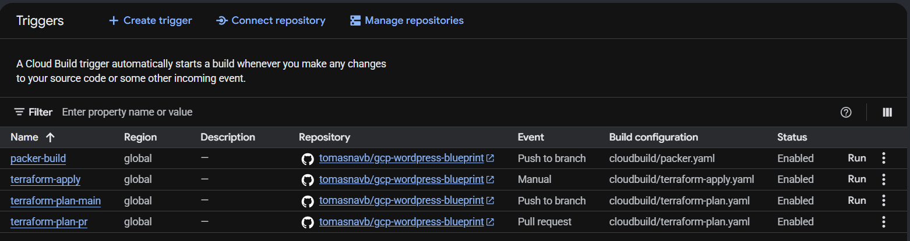

**Cloud Build — Plan and apply.** A plan generated on `main`, the apply of that plan, and the build of the backup function that the apply starts in `europe-west1`.

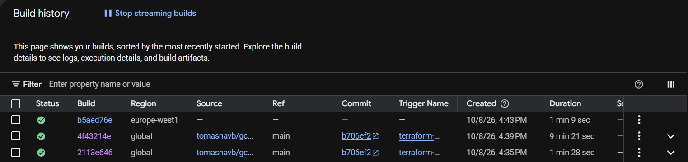

### Compute

**Compute Engine — VM instances.** The management VM, since removed, and a WordPress instance of the MIG. Neither has an external IP.

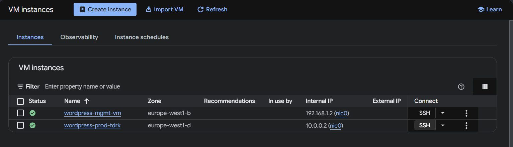

**Load balancer — Healthy backend.** The MIG as backend of the load balancer. An instance counts as healthy only after its startup script has finished configuring it.

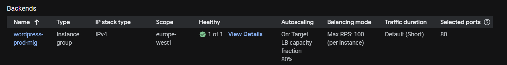

### Data

**Cloud SQL — Instance.**

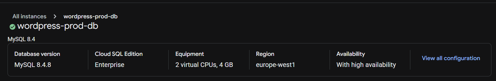

**Secret Manager — Secrets.**

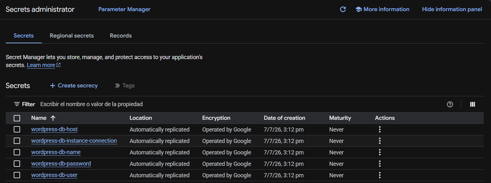

**Cloud Scheduler — Backup jobs.** The export job, and the snapshot job since removed, after a successful run.

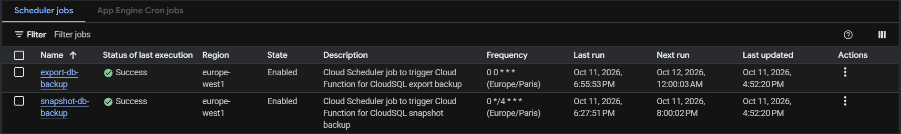

**Cloud Storage — Uploads in the bucket.** A file uploaded from WordPress, stored in the bucket that every instance mounts with Cloud Storage FUSE. The folder was `uploads/` at the time; it is now `wp-content/uploads/`.

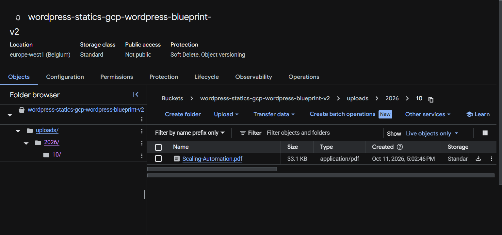

### HTTPS

**HTTP redirects to HTTPS.** A request on port 80 is answered with a 301 to the HTTPS URL.

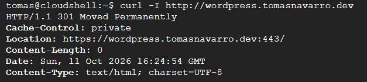

**TLS 1.1 is rejected.** The SSL policy of the load balancer accepts TLS 1.2 and later only.

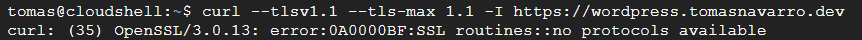

### WordPress

**Setup over HTTPS.** The installer under `/wp-admin`, served on the domain through the load balancer with the managed certificate. Since the refactor it is only reachable through IAP.

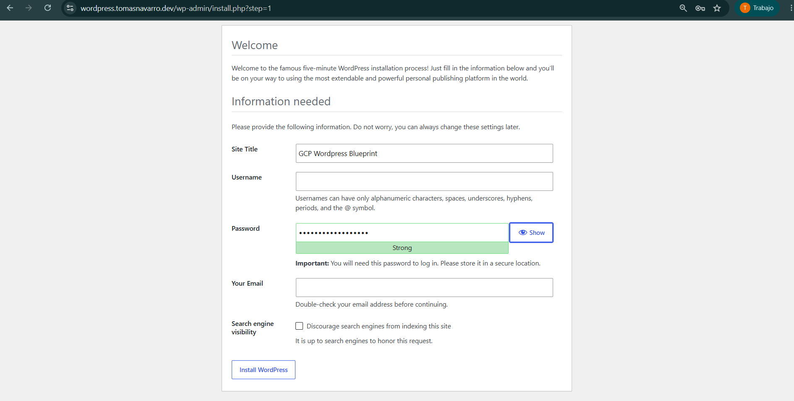

**Online via the load balancer.**

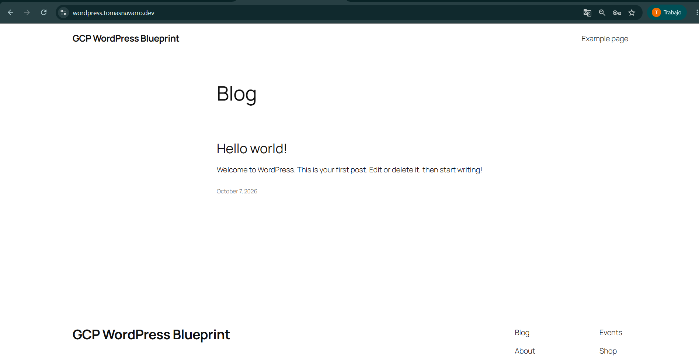

---

## Roadmap

Features not implemented in this version but planned as natural next steps:

- **Cloud Monitoring & Alerting** — uptime checks on the load balancer IP, alert policies for Apache error rate and instance health, Cloud Ops Agent for OS-level and Apache metrics (requests/s, latency, error rate)
- **Staging environment** — a second project with the same code, its own variable file and its own state, with the network in a separate root
- **Terraform tests** — infrastructure validation using `terraform test` or Terratest
- **Multi-region failover** — add a Cloud SQL cross-region replica that can be promoted, and a second MIG in another region behind the same global load balancer
